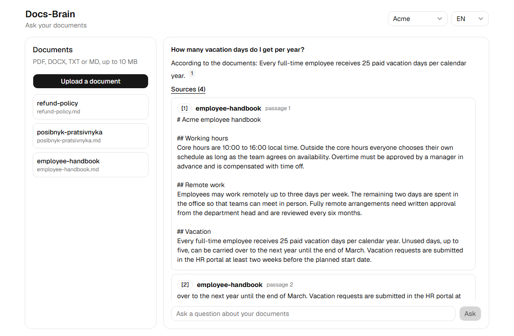
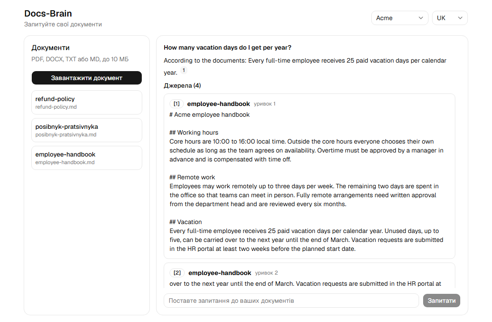
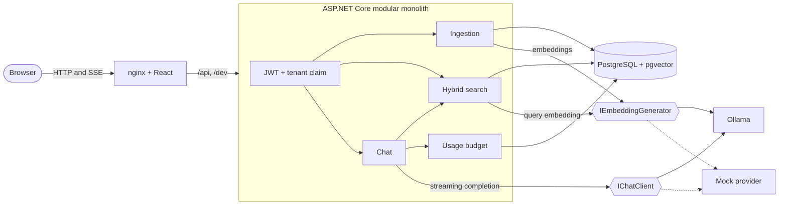
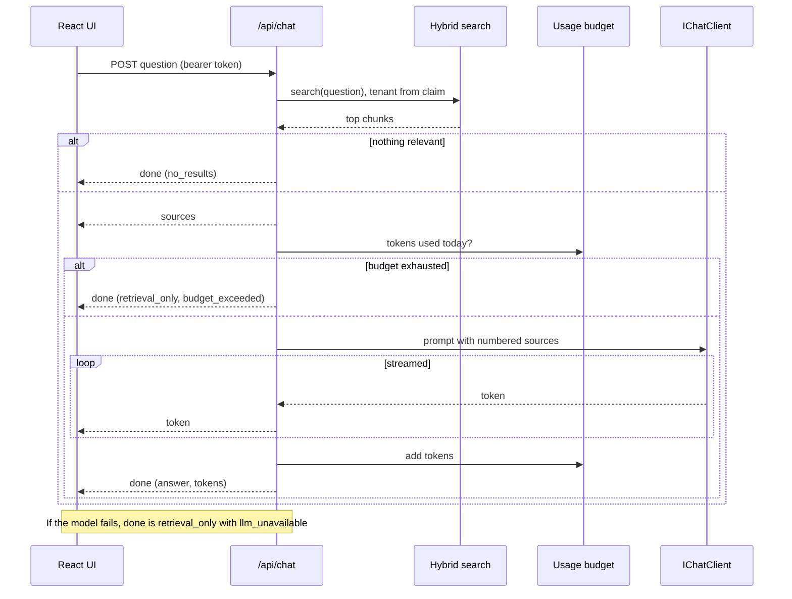
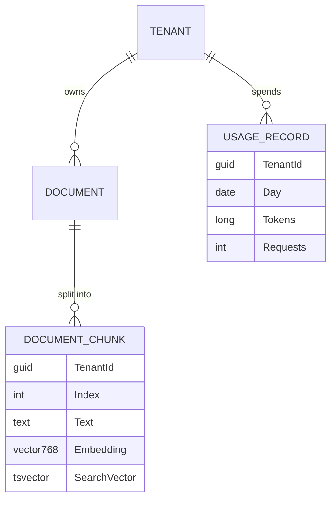

# Docs-Brain

Multi-tenant RAG assistant. Upload documents, ask questions, get streamed answers that cite their sources. It runs fully locally with `docker compose up`, uses free local models through Ollama and has an offline mock provider for tests and CI.





## What it shows
- **Multi-tenancy:** a JWT `tenant_id` claim, EF Core global query filters, fail-closed behaviour, explicit tenant predicates in raw SQL ([ADR 2](docs/adr/0002-tenant-isolation.md)).
- **RAG pipeline:** upload, text extraction (PDF, DOCX, TXT, MD), paragraph-aware chunking with overlap ([ADR 3](docs/adr/0003-ingestion-pipeline.md)).
- **Hybrid search:** pgvector (HNSW, cosine) and PostgreSQL full text merged with Reciprocal Rank Fusion, degrading to keyword search when the embedding model is down ([ADR 4](docs/adr/0004-embeddings-and-hybrid-search.md)).
- **AI abstraction and cost governance:** `Microsoft.Extensions.AI` over Ollama or a mock, daily token budget per tenant, rate limiting, retrieval-only fallback ([ADR 5](docs/adr/0005-chat-streaming-and-cost-governance.md)).
- **Streaming UI:** React with server-sent events, clickable citations, `en` and `uk` locales, built with shadcn/ui ([ADR 6](docs/adr/0006-web-ui-shadcn.md)).
- **Quality gates:** unit and integration tests on real PostgreSQL (Testcontainers), retrieval evals, Playwright E2E, GitHub Actions for build and test.

## Run it
```powershell
docker compose up --build
```
Open http://localhost:8090. The first start pulls two Ollama models (`nomic-embed-text` and `llama3.2:3b`, about 2.5 GB). Two demo workspaces, Acme and Globex, are seeded with sample documents (one of them is in Ukrainian). Switch workspace in the top bar to see that their documents are isolated.

Offline, without downloading any model:
```powershell
$env:COMPOSE_PROFILES = ""; $env:AI_PROVIDER = "mock"; $env:SEARCH_MIN_SIMILARITY = "0.2"
docker compose up --build
```
The mock provider embeds text as hashed bags of words and answers with the most relevant sentence of the sources. It is deterministic, which is what the tests and evals rely on.

The compose stack runs the API in the `Development` environment, because the demo signs in through `/dev/token`. There is no real identity provider yet.

### Development
```powershell
docker compose up -d postgres          # database only
dotnet run --project src/DocsBrain.Api  # API on http://localhost:5201 (needs Ollama or Ai__Provider=mock)
cd web; npm install; npm run dev        # UI on http://localhost:5173, proxies /api to the API
```
Set `Seed__Enabled=true` to load the sample documents.

### Tests
```powershell
dotnet test                             # unit, integration (needs Docker) and retrieval evals
cd web; npm test; npm run lint          # frontend unit tests and lint
cd web; npx playwright test             # E2E against the running compose stack (mock provider)
```

## Architecture


### Asking a question


### Data model


## API
| Endpoint | Purpose |
| --- | --- |
| `POST /dev/token` | Development only: token for tenant `1111...` (Acme) or `2222...` (Globex) |
| `GET /api/documents`, `GET /api/documents/{id}`, `GET /api/documents/{id}/chunks` | Documents of the caller's tenant |
| `POST /api/documents/upload` | Multipart field `file`: PDF, DOCX, TXT or MD, up to 10 MB |
| `GET /api/search?q=...&limit=5` | Hybrid search |
| `POST /api/chat` | `{"question":"...","context":"..."}` (`context` optional, trusted facts from a calling service, at most 4000 characters). Streams `sources`, `token` and `done` events |
| `GET /health` | Health check |

Budgets and limits live under `Chat` in `appsettings.json`, models under `Ai`, the vector match threshold under `Search`.

## Evals
`RetrievalEvalTests` ingests the seed documents into an isolated database and runs the questions in [retrieval-cases.json](tests/DocsBrain.Tests/Evals/retrieval-cases.json) with the mock provider. It reports hit@1, hit@3, MRR and whether the top three passages contain the answer, and fails the build below the baseline. Current baseline: hit@3 100%, MRR 0.94, context recall@3 100%.

## Limits and next steps
- Sign-in is a demo shortcut. A real OIDC provider (Keycloak, as in Orderflow) would replace `/dev/token`.
- The schema is created with `EnsureCreated`; EF migrations are the next step.
- Ingestion runs inside the upload request. A background queue would suit large files.
- Chunks stored without a vector (model was down) are not re-embedded automatically.
- Answer caching is not implemented.
- `nomic-embed-text` is English-centric; `bge-m3` is better for Ukrainian but needs a schema change (1024 dimensions).

## Architecture decisions
- [ADR 1: Modular monolith on PostgreSQL with pgvector](docs/adr/0001-modular-monolith-with-pgvector.md)
- [ADR 2: Tenant isolation](docs/adr/0002-tenant-isolation.md)
- [ADR 3: Ingestion pipeline](docs/adr/0003-ingestion-pipeline.md)
- [ADR 4: Embeddings and hybrid search](docs/adr/0004-embeddings-and-hybrid-search.md)
- [ADR 5: Streamed chat and cost governance](docs/adr/0005-chat-streaming-and-cost-governance.md)
- [ADR 6: Web UI with shadcn/ui](docs/adr/0006-web-ui-shadcn.md)
- [ADR 7: Service calls and trusted context](docs/adr/0007-service-calls-and-trusted-context.md)
- [ADR 8: Shared corpus](docs/adr/0008-shared-corpus.md)

## Calls from other services
Another service can call the API with a token of an external OpenID Connect authority. Set `Auth__Authority` (and `Auth__Issuer` when it differs, `Auth__Audience`, `Auth__ServiceRole`). A caller with the service role names the tenant in the `X-Tenant-Id` header and may send `context` with the question. See [ADR 7](docs/adr/0007-service-calls-and-trusted-context.md).

### Shared corpus
Knowledge that every tenant should be able to search (for example plant care texts) lives in a shared corpus, managed by a service with the service role: `PUT /api/shared/documents/{title}` (multipart `file`, replaces the previous version of that title), `GET /api/shared/documents`, `DELETE /api/shared/documents/{id}`. Tenants find these passages in search and chat (marked `shared`) but cannot write them. See [ADR 8](docs/adr/0008-shared-corpus.md).
